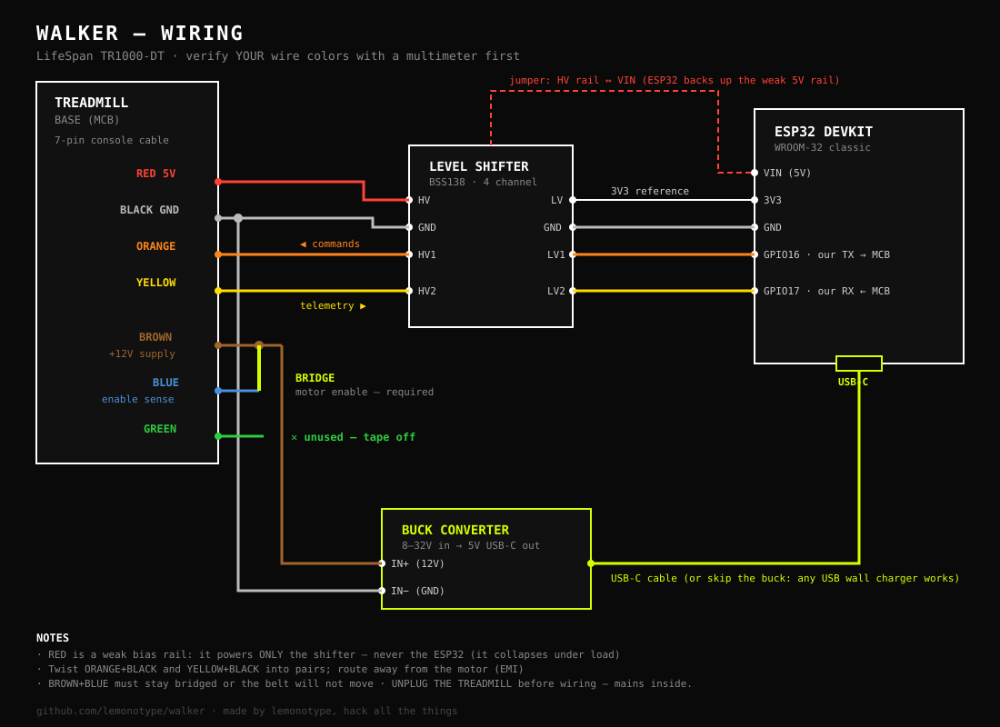
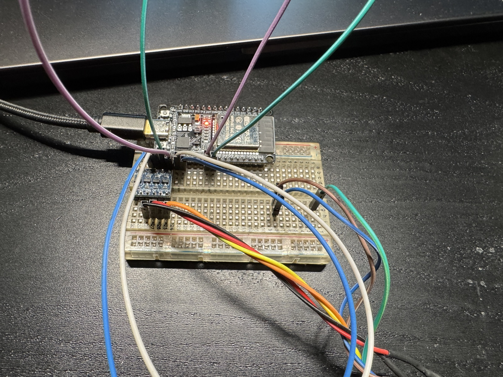
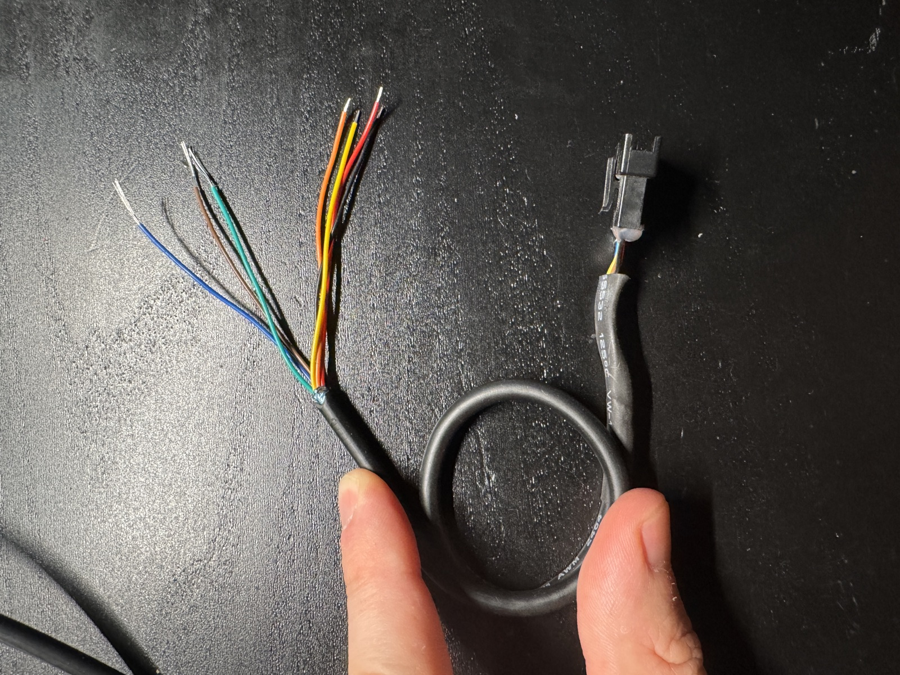
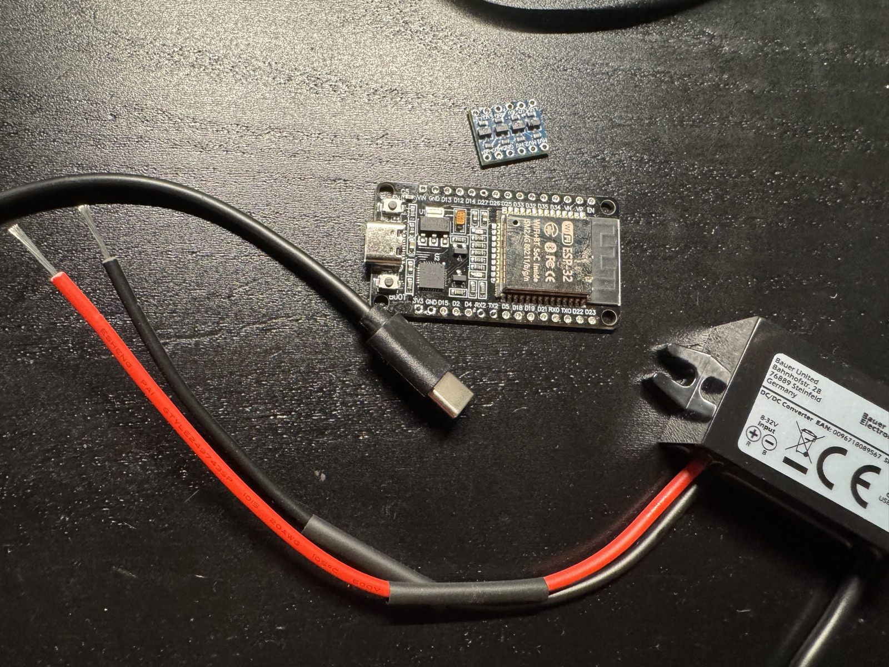
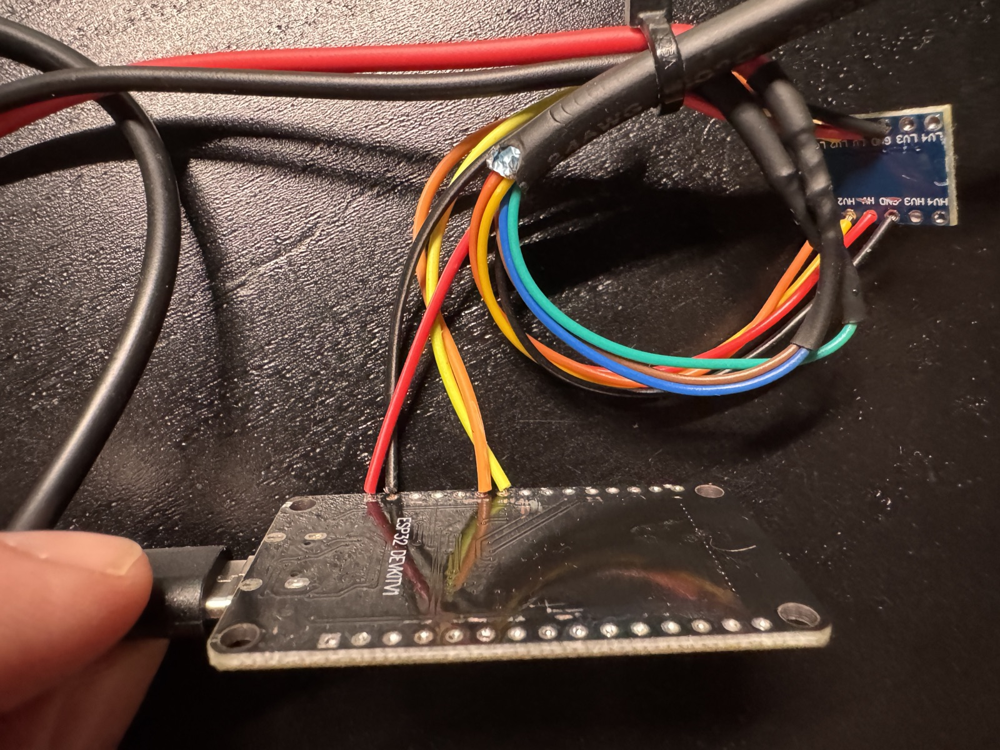
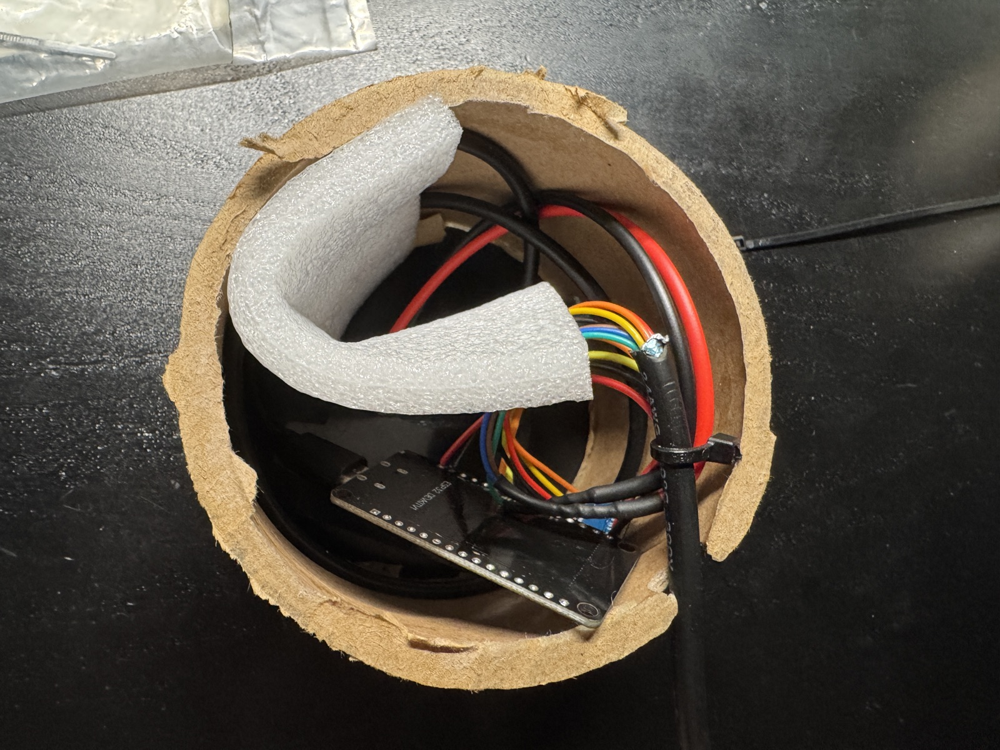
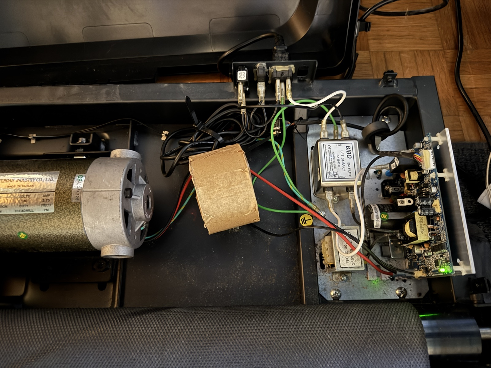
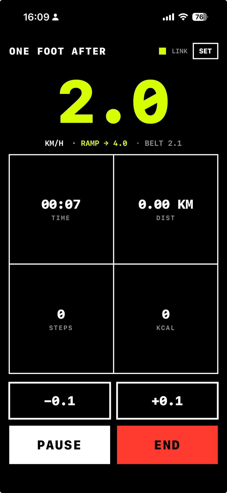
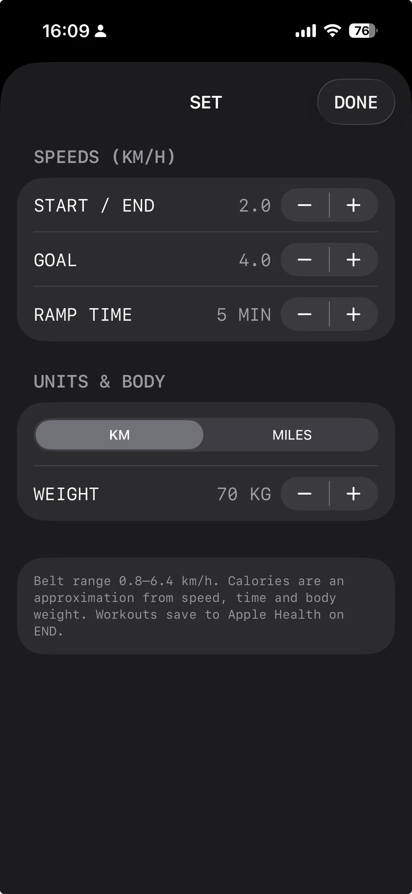
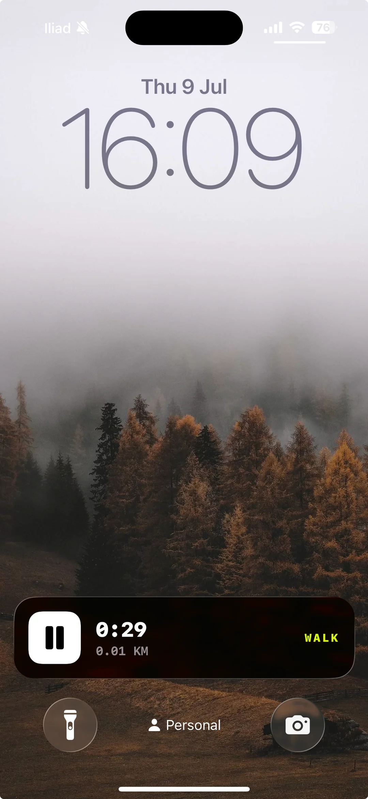

# Walker

**Open-source console replacement for LifeSpan under-desk treadmills.**

A €15 ESP32 replaces the original console entirely: it speaks the motor
board's native protocol (Modbus RTU) and exposes the treadmill as a standard
**Bluetooth FTMS fitness machine** — controlled by the included iOS and
Android apps, with automatic workout sync to Apple Health / Health Connect.

Born from a LifeSpan **TR1000-DT** whose desk console went to the landfill.
Very likely works on the TR1200/TR800 DT family (same protocol observed by
[treadspan](https://github.com/blak3r/treadspan)) — verify your wiring first.

- **START** → belt ramps gently from your start speed to your goal speed
- Live speed / time / distance / **steps** (counted by the treadmill itself) / calories
- Session goals (time, distance, or steps) with automatic wind-down and end
- Lock-screen play/pause, lifetime + 30-day stats, maintenance reminders
- Every ended session lands in Apple Health / Health Connect automatically

**Everything here is free (MIT).** Fork it, build on it, sell nothing or
everything, just don't blame us — see the disclaimer.

---

## ⚠️ Disclaimer

You are wiring a microcontroller to a machine with a motor strong enough to
throw you off it, whose base contains **mains voltage**. Nothing here stops
the belt if your firmware locks up while you're mid-espresso (the motor board
happily runs forever without a master — we proved it). Unplug the treadmill
before touching wiring. No warranty of any kind; you do this at your own risk.

---

## Hardware you need

| Item | ~Cost | Notes |
|---|---|---|
| ESP32 DevKit (classic WROOM-32, USB-C or micro) | €8–15 | e.g. ELEGOO/DOIT "ESP32 DEVKIT V1"; CP2102 serial |
| 4-channel bidirectional level shifter (BSS138 type) | €2–6 | The treadmill bus is 5V; the ESP32 is 3.3V |
| Jumper wires + a small breadboard | €5 | Or solder, when you're sure |
| USB power brick **or** DC-DC buck 8–32V→5V USB-C | €3–13 | The buck lets the treadmill power the ESP32 itself |
| Multimeter | — | Non-negotiable. You will verify every wire |

## Wiring (TR1000-DT wire colors — VERIFY YOURS)



The console connects to the base with a 7-pin cable. On our TR1000-DT:

| Wire | Role (verified) | Connect to |
|---|---|---|
| **Black** | GND | Level shifter GND (both sides) + ESP32 GND |
| **Red** | +5V *bias* rail (weak! signal reference only) | Shifter **HV** |
| **Orange** | MCB's RX — commands go in here | Shifter **HV1** ← **LV1** ← ESP32 **GPIO16** |
| **Yellow** | MCB's TX — telemetry comes out here | Shifter **HV2** ← **LV2** ← ESP32 **GPIO17** |
| **Brown** | +12V console supply (the real power) | **Bridge to blue**, and buck **IN+** |
| **Blue** | Enable/presence sense | **Bridge to brown** (motor will not run otherwise) |
| **Green** | Ground return (GND-ish) | Buck **IN−** (as built) — or leave unused |
| ESP32 **3V3** | | Shifter **LV** |

Verification ritual before trusting any color: with the treadmill powered and
console absent, black↔red ≈ 5V, brown↔blue ≈ 12V (across the *pair* — it can
float relative to black), orange/yellow idle high. Colors may differ between
production runs.

**Two hard-won facts** (details in [docs/reverse-engineering-notes.md](docs/reverse-engineering-notes.md)):
1. Orange/yellow are separate point-to-point UART lines, not a shared bus.
2. The red 5V rail collapses under >~30mA — it cannot power the ESP32.
   Power the ESP32 from USB, or from brown 12V through a buck converter
   (which conveniently sits exactly where the console's own power draw sat).

## As built: powered by the treadmill itself

The finished install runs with **no external cables at all**: the buck
converter's **red input lead → the brown+blue bridge node (+12V)**, its
**black input lead → green (ground return)**, and its USB-C output powers
the ESP32. ESP32 + level shifter + buck all fit inside the treadmill base.

### ☠️ BIG WARNING — READ BEFORE OPENING THE BASE

The base contains mains voltage **and big capacitors that stay charged after
you pull the plug**. In the words of the author, who found out empirically:

> even with power pulled I touched something that almost blasted my balls off

That something was the motor-drive capacitor bank (there's a 470µF capacitor
in there that sits at up to ~400V). Unplug, **wait several minutes**, keep
your fingers away from the power-supply corner of the board, work
one-handed near it, and never trust a capacitor to be empty.

## Build photos

| | |
|---|---|
|  *Breadboard prototype: ESP32 + level shifter tapped into the console cable* |  *The 7-pin console cable, spliced* |
|  *The whole brain: ESP32, level shifter, 12V→5V buck* |  *Breadboard retired — soldered for the final install* |
|  *Everything tucked into the base* |  *The base open: motor, EMI filter, MCB — and the capacitors that bite* |

## Flashing the ESP32

```bash
brew install arduino-cli        # or your platform's equivalent
arduino-cli config init
arduino-cli config add board_manager.additional_urls https://espressif.github.io/arduino-esp32/package_esp32_index.json
arduino-cli core update-index
arduino-cli core install esp32:esp32

cd firmware/lifespan_console
arduino-cli compile --fqbn esp32:esp32:esp32:PartitionScheme=huge_app .
arduino-cli upload  --fqbn esp32:esp32:esp32:PartitionScheme=huge_app -p /dev/cu.usbserial-0001 .
```

(`PartitionScheme=huge_app` is required — BLE doesn't fit the default
partition. Find your port with `arduino-cli board list`.)

Open a serial monitor at **115200** for a live debug console: `s`/`x`
start/stop, `1`–`6` speed in km/h, `+`/`-` nudge, `d` hex dump, `w` waveform
analyzer, `z` Modbus address/baud scanner — the full toolkit we used to
reverse this thing.

The firmware advertises as **"LifeSpan TR1000"** with standard FTMS
(service 0x1826), so QZ, Kinni and friends also work out of the box.

## iOS app (Walker)

| Main | Settings | Lock screen |
|---|---|---|
|  |  |  |

**Known bug:** the lock-screen play/pause button may still demand Face ID /
passcode before acting. `authenticationPolicy = .alwaysAllowed` is set (as a
stored property, as required), but iOS couldn't be reliably convinced —
sometimes it just works, sometimes it asks. If you figure out the missing
incantation, a PR would make a lot of walkers happy.

Sideloading needs a Mac with Xcode and an Apple ID (free works, re-sign
weekly; a paid dev account makes it permanent + TestFlight-able).

```bash
brew install xcodegen
cd ios/LifeSpanWalk
xcodegen generate
open LifeSpanWalk.xcodeproj
```

In Xcode: select the **LifeSpanWalk** target → *Signing & Capabilities* →
tick *Automatically manage signing* → choose your team (repeat for the
**WalkWidgets** target) → plug in your iPhone → press ▶. First launch asks
for Bluetooth; first START asks for Apple Health. TestFlight steps are in
[ios/LifeSpanWalk/README.md](ios/LifeSpanWalk/README.md).

## Android app (Walker)

Just want to use it? Sideload **[android/Walker-v1.0.apk](android/Walker-v1.0.apk)**
(Android 12+). Build instructions in [android/README.md](android/README.md).

## Protocol (for the curious and the porters)

Motor board = Modbus RTU slave `0x01`, 4800 8N1 over 5V UART:

| Register | Meaning |
|---|---|
| `0x0001` write 1 | Start belt |
| `0x0002` write 1 | Stop belt |
| `0x000A` write | Speed setpoint: value = 146.03 × km/h, 50 = stopped |
| `0x000F` read / write 0 | Step count / reset |
| `0x0101` read | Version (0x2001) |
| `0xD10A` read | Actual belt speed |

The ESP32 bridges this to BLE FTMS (Treadmill Data `0x2ACD`, Control Point
`0x2AD9`, Status `0x2ADA`) plus a custom step-count characteristic
(`7C9A0002-3D3A-4E7B-8A10-25C1D9E0F2A4`, uint32 LE). Full war story:
[docs/reverse-engineering-notes.md](docs/reverse-engineering-notes.md).

## 🤖 Hacking on this with an AI (Claude, etc.)

This repo ships a [CLAUDE.md](CLAUDE.md) that briefs AI coding agents on the
architecture, protocols, build commands and the sharp edges we already cut
ourselves on. Clone the repo, open it with [Claude Code](https://claude.com/claude-code)
(or your agent of choice), and ask for what you want:

> *"Add a web dashboard served from the ESP32"*
> *"Port the app to Wear OS"*
> *"Add incline support for the TR5000 — here's my sniffer capture"*

The agent gets the tribal knowledge from CLAUDE.md automatically; the
firmware's built-in diagnostic commands (`z` scanner, `w` waveform analyzer)
give it eyes on your hardware. That's how this entire project was built —
one evening of human-and-Claude vs. seven mystery wires.

## Credits

- [blak3r/treadspan](https://github.com/blak3r/treadspan) — first public
  capture of the wired console protocol; register map confirmation
- The [daeken gist](https://gist.github.com/daeken/a3d3c4da11ca1c2d2b84)
  comment crew — pinouts, MCU identification, years of breadcrumbs
- made by **lemonotype & claude**

## License

[MIT](LICENSE). Free forever, for anyone.
